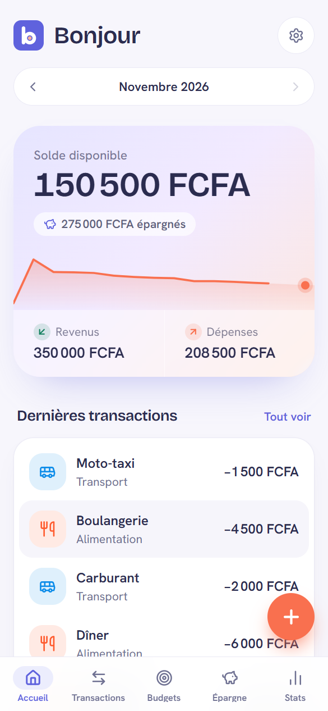
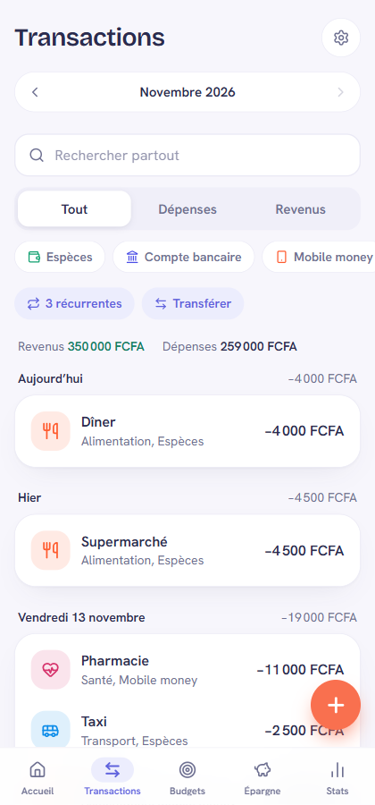
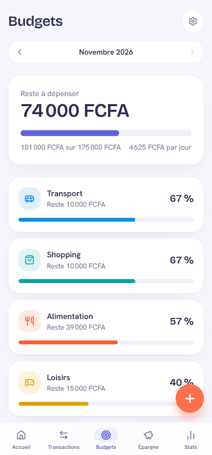
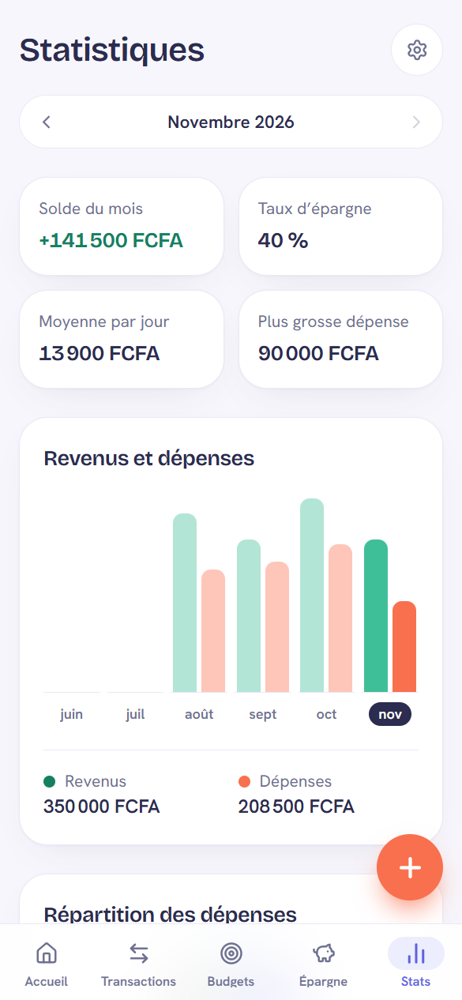
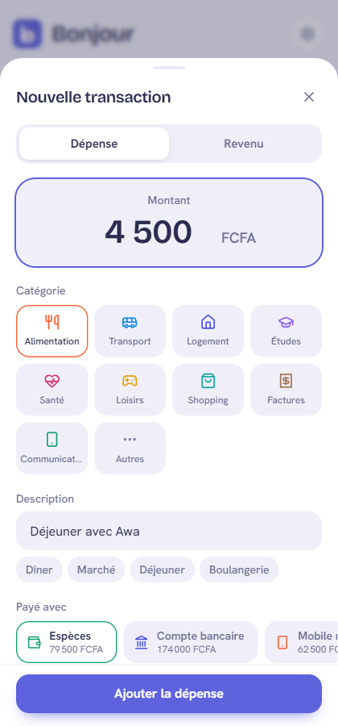
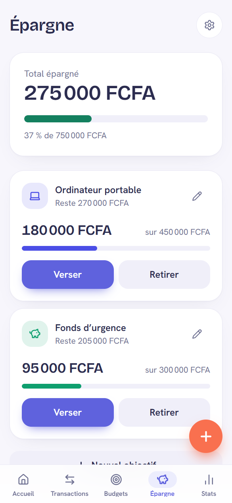
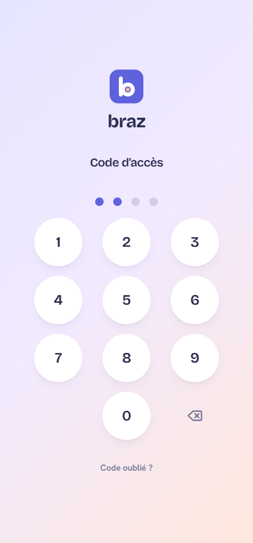
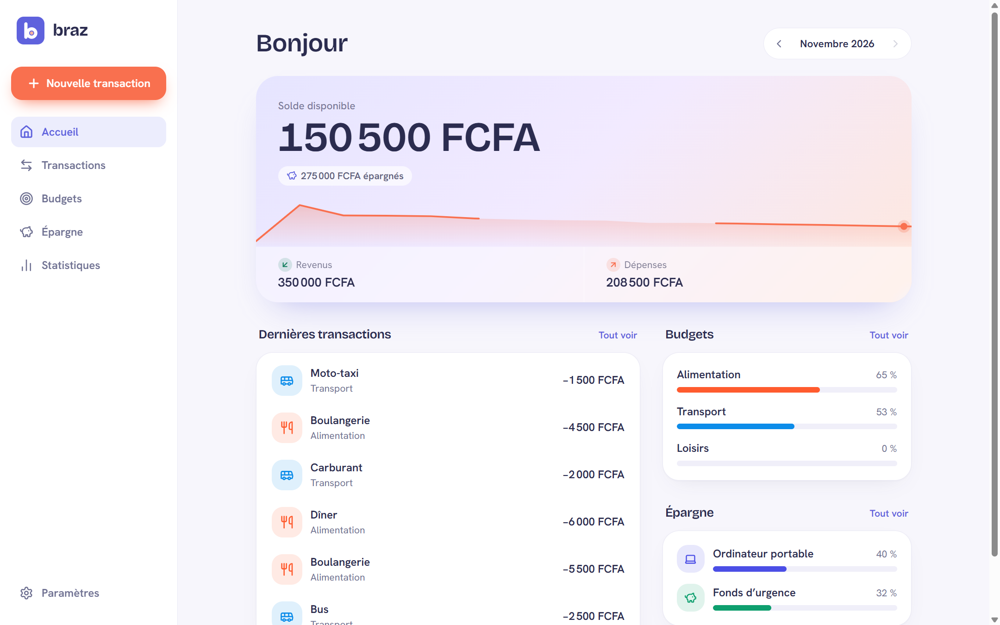
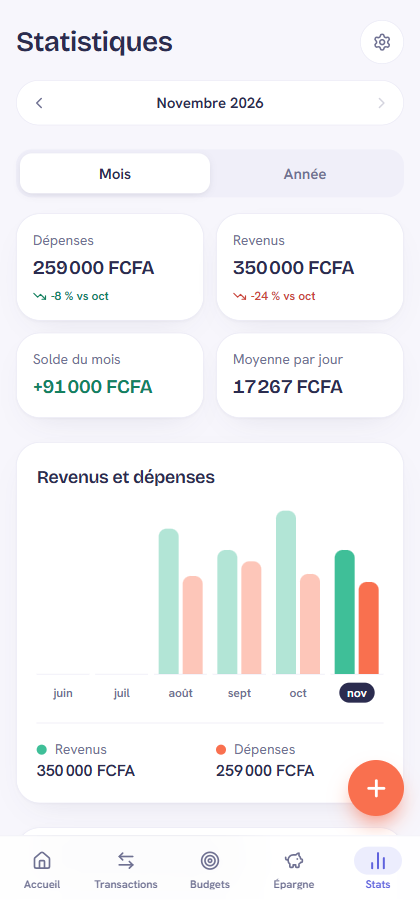

<div align="center">
  
  <h1>BRAZ</h1>
  <p><b>Vos finances personnelles, simplement.</b><br />
  Revenus, dépenses, budgets et épargne dans une application installable qui fonctionne hors ligne.</p>
</div>

<p align="center">
  
  
  
  
</p>

## Fonctionnalités

| | |
|---|---|
| **Tableau de bord** | Solde disponible, revenus et dépenses du mois, courbe d'évolution, dernières transactions. |
| **Transactions** | Ajout en quelques secondes, modification, suppression, recherche, filtres par type et par catégorie. |
| **Récurrences** | Salaire, loyer, abonnements : cochez « Répéter chaque mois » et la transaction s'ajoute seule chaque mois. |
| **Catégories** | Quinze catégories prêtes à l'emploi, personnalisables (nom, icône, couleur). |
| **Budgets** | Une limite mensuelle par catégorie, avec le reste à dépenser et le montant disponible par jour. |
| **Épargne** | Des objectifs avec versements, retraits et progression. L'argent mis de côté est déduit du solde disponible. |
| **Statistiques** | Revenus et dépenses sur six mois, répartition par catégorie, taux d'épargne, moyenne par jour. |
| **Code d'accès** | Verrouillage par code à 4 chiffres à l'ouverture de l'application. |
| **Données** | Export et restauration d'une sauvegarde JSON, export CSV des transactions. |

Devise FCFA par défaut (XOF, euro et dollar disponibles). Interface en français.

## Aperçu

<p align="center">
  
  
  
</p>

<p align="center">
  
  
</p>

Les montants des captures sont des données d'exemple.

## Vie privée

Il n'y a ni compte, ni serveur, ni suivi. Toutes les données restent sur l'appareil, dans IndexedDB.

- Les données ne se synchronisent pas entre appareils : utilisez l'export et la restauration pour les transférer.
- Le code d'accès verrouille l'écran, il ne chiffre pas les données.
- Effacer les données du navigateur efface aussi celles de BRAZ : exportez une sauvegarde régulièrement.

## Installer l'application

Ouvrez l'adresse de l'application sur votre téléphone, puis :

- **Android (Chrome)** : menu ⋮ → « Installer l'application ».
- **iPhone (Safari)** : Partager → « Sur l'écran d'accueil ».

Une fois installée, elle s'ouvre en plein écran et fonctionne sans connexion.

## Développement

Prérequis : Node.js 20 ou plus récent.

```bash
npm install
npm run dev      # serveur de développement
npm run build    # vérification TypeScript + build de production dans dist/
npm run preview  # sert le build, service worker compris
```

`node scripts/icons.mjs` régénère les icônes de l'application à partir du logo.

### Organisation

```
src/
  App.tsx        navigation, mise en page, verrouillage
  store.tsx      état de l'application, synchronisé avec IndexedDB
  db.ts          accès IndexedDB
  lib.ts         dates, montants, calculs, sauvegarde
  ui.tsx         composants de base (boutons, feuilles, champs, animations)
  forms.tsx      formulaires (transaction, budget, objectif, catégorie)
  lock.tsx       code d'accès
  charts.tsx     graphiques SVG
  pages/         les six écrans
```

### Technique

React 19, TypeScript, Vite, Tailwind CSS 4, `vite-plugin-pwa` (service worker Workbox). Graphiques et accès IndexedDB écrits à la main, sans bibliothèque supplémentaire.

## Déploiement

Le dépôt est prêt pour Vercel : importez-le, la configuration est dans [`vercel.json`](vercel.json). Tout hébergement statique en HTTPS convient, en servant le dossier `dist/`.
